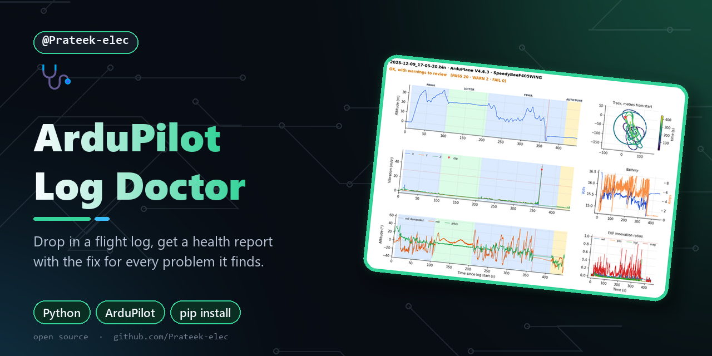
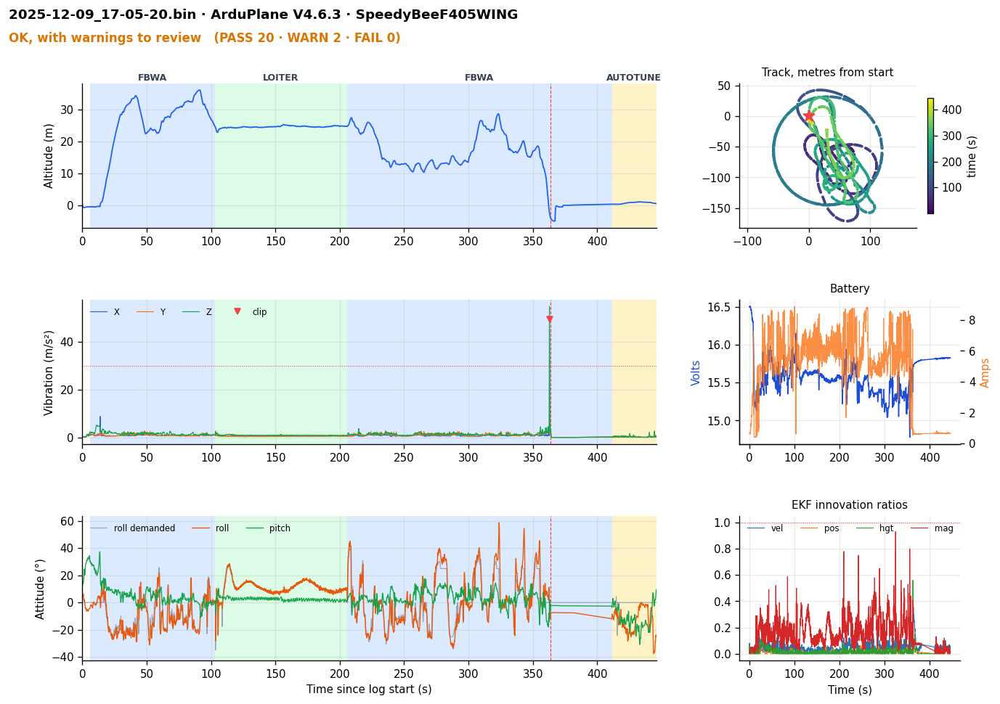

<div align="center">



**Your drone crashed. Your log already knows why.**

Point Log Doctor at an ArduPilot DataFlash log (`.BIN`) and get a pass / warn / fail health report in seconds: vibration, clipping, EKF, power, GPS, compass, tuning and failsafes, with what to fix for every problem it finds. No MATLAB, no web upload, just Python.


</div>

---

## Quick start

```bash
pip install git+https://github.com/Prateek-elec/ardupilot-log-doctor
log-doctor 00000042.BIN
```

You get the report in the terminal, plus a Markdown report and a one-page figure next to the log.

```text
ArduPilot Log Doctor · 2025-12-09_17-05-20.bin
ArduPlane V4.6.3 on SpeedyBeeF405WING · log length 07:25
  Flight time: 5.8 min in 1 flight(s)
  Max altitude above home: 36 m
  Distance flown: 3.89 km
  Battery: 4S, 16.50 V at start, 587 mAh used

  PASS  Vibration IMU0 (95th pct, in flight)          2.1 m/s²                 limit < 30 (warn < 60)
  PASS  Accel clipping IMU0 (in flight)               0                        limit 0
  WARN  Accel clipping IMU0 (takeoff / touchdown)     13                       limit 0
  PASS  Battery sag under load                        6.6 % (15.82 → 14.78 V)  limit < 15 % (warn < 25)
  PASS  Lowest cell voltage in flight (4S)            3.69 V                   limit > 3.5 V (warn > 3.3)
  PASS  EKF compass innovation ratio (95th pct)       0.36                     limit < 0.5 (warn < 1)
  PASS  Roll tracking error (RMS, in flight)          6.0°                     limit < 8 (warn < 12)
  ...
  PASS 20   WARN 2   FAIL 0   →  OK, with warnings to review

What to look at:
  • Accel clipping IMU0 (takeoff / touchdown): Clipping only at touchdown or launch is usually the impact itself...

Flight modes: FBWA (00:06) → LOITER (01:43) → FBWA (03:25) → AUTOTUNE (06:51)
```


<sub>The figure for the same flight. The full Markdown report is in <a href="docs/example_report.md">docs/example_report.md</a>; the log is the real flight log from my <a href="https://github.com/Prateek-elec/rc-plane-speedybee-wing405">scratch-built ArduPilot plane</a>.</sub>

## Highlights

- 🩺 **20+ checks in one command:** the things people ask about on the forums after a bad flight, graded against common ArduPilot guidance.
- 🛬 **Knows a hard landing from a vibration problem.** Accelerometer clipping at takeoff or touchdown is reported separately, so one firm landing doesn't fail an otherwise healthy flight.
- 🛩️ **Copter and Plane aware:** it detects the vehicle, names the flight modes, and uses the right tracking limits for each.
- 🧰 **Tells you what to do.** Every warning and failure comes with a fix to try first.
- 🔒 **Private by default.** Everything runs locally, and the report never prints GPS coordinates or the board's serial number; the track is drawn in metres from the start.
- 🛑 **Never a false all-clear.** Empty, corrupted or non-DataFlash files are rejected, a log that stops mid-flight is flagged as a crash signature, and anything it couldn't check is listed under *Not checked* (with an INCOMPLETE verdict when too little is there).
- 🎛️ **Your airframe, your limits:** every pass / warn limit can be changed in a small JSON file.
- 🧪 **Scriptable and tested:** `--json` output, CI-friendly exit codes, and 44 tests on synthetic logs with injected faults.

## What it checks

| Area | Check | Pass | Warn |
|---|---|---|---|
| **Vibration** | 95th percentile of the worst axis in steady flight, per IMU | < 30 m/s² | < 60 m/s² |
| **Clipping** | Accelerometer clips in flight, and separately at takeoff / touchdown | 0 | – |
| **Power** | Board 5 V rail | 4.8 – 5.4 V | ≥ 4.6 V |
| | Battery sag under load | < 15 % | < 25 % |
| | Lowest cell voltage in flight (cell count detected) | > 3.5 V | > 3.3 V |
| | Current while disarmed (sensor offset or a hungry peripheral) | < 1 A | < 3 A |
| **EKF** | Velocity, position, height and compass innovation ratios | < 0.5 | < 1 |
| **Compass** | Field change between low and high current (motor interference) | < 30 % | < 60 % |
| **Tuning** | Roll and pitch tracking error in flight (yaw too on copters) | copter < 3°, plane < 8° | copter < 6°, plane < 12° |
| **GPS** | 3D fix time, satellites, HDOP | > 95 %, ≥ 10, < 1.5 | > 80 %, ≥ 6, < 2.5 |
| **Sensors** | Gyro noise at rest, IMU0 vs IMU1 agreement | < 0.3 °/s, < 0.5 m/s² | < 1 °/s, < 1 m/s² |
| **CPU** | Load and long loops | < 70 %, < 5 % | < 85 %, < 15 % |
| **Safety** | Pre-arm checks disabled (`ARMING_CHECK = 0`), forced arming | enabled, 0 | – |
| **Log integrity** | Log ends while flying (crash / power loss), damaged records | lands and disarms, 0 | – |
| **Events** | ERR subsystems decoded (failsafes, crash check, EKF lane switches…) and notable messages | 0 | – |

Plus a flight summary (flight time, max altitude, speed, distance, battery used) and a flight-mode timeline.

The limits are rules of thumb that suit most small and medium multirotors and planes. A big heavy-lift frame or a racing quad may need different ones; treat a WARN as "look at this", not "this is broken", and adjust them:

```bash
log-doctor --print-limits > my_limits.json      # all defaults, edit what you need
log-doctor flight.BIN --limits my_limits.json   # a file with only the limits you change also works
```

```json
{ "_comment": "6S heavy-lift", "vibration_mss": { "pass_below": 20, "warn_below": 40 },
  "cell_min_v": { "pass_at_least": 3.6, "warn_at_least": 3.4 } }
```

## Options

```text
log-doctor LOG [LOG ...]       one or more logs, wildcards work (log-doctor logs/*.BIN)
  --out DIR                    where to write the .md report and .png figure (default: next to the log)
  --no-plot                    skip the figure
  --no-files                   print the report only
  --json                       machine-readable output (several logs: one JSON array)
  --limits FILE                JSON file overriding some or all pass / warn limits
  --print-limits               print the default limits as JSON
  --strict                     exit code 1 if any check fails
```

**Exit codes:** `0` analysed, `1` a check failed (only with `--strict`), `2` a log or the limits file couldn't be read.

Or from Python:

```python
from log_doctor import analyse

report = analyse("00000042.BIN")
print(report.status, report.verdict)        # PASS / WARN / FAIL / INCOMPLETE
for check in report.checks:
    print(check.status, check.name, check.measured, check.value)
```

## Why not just Mission Planner?

Mission Planner shows you the graphs; Log Doctor tells you what they mean. It's a 10-second first look: pass / warn / fail against known limits, with what to fix, so you know where to dig before opening the graphs. It also tells a hard landing apart from a vibration problem, flags disabled safety checks, runs on Windows, Mac and Linux, and batches a whole folder of logs.

## Getting a log

- **SD card:** copy the `.BIN` files from `APM/LOGS/`.
- **Mission Planner:** DATA tab → DataFlash Logs → *Download DataFlash Log Via Mavlink*.
- **QGroundControl:** Analyze Tools → Log Download.

## Limits

- Built and tested against ArduCopter and ArduPlane 4.x logs. Rover and Sub logs load, but some checks don't apply to them yet.
- It doesn't analyse vibration frequencies (FFT) or suggest harmonic notch settings yet.
- A clean report doesn't mean an aircraft is airworthy. Pre-flight checks still apply.

## Related

- [**ArduPilot Flight Test Lab**](https://github.com/Prateek-elec/ardupilot-flight-test-lab): the MATLAB toolkit this grew out of, with system identification, LQR-designed PID tunes and SITL / HIL testing.
- [**Scratch-built ArduPilot plane**](https://github.com/Prateek-elec/rc-plane-speedybee-wing405): the airframe behind the example report.

## Contributing

Bug reports with a log that trips it up are the most useful thing you can send. Open an issue, describe the vehicle, and attach the log (or a link) if you're happy to share it. Run the tests with:

```bash
pip install -e .[test]
pytest
```

See [CONTRIBUTING.md](CONTRIBUTING.md) and the [changelog](CHANGELOG.md).

## License

[MIT](LICENSE) © Prateek Sarkar

---

<div align="center">

**If Log Doctor found something in your log, give it a ⭐ so other pilots can find it too.**

</div>
