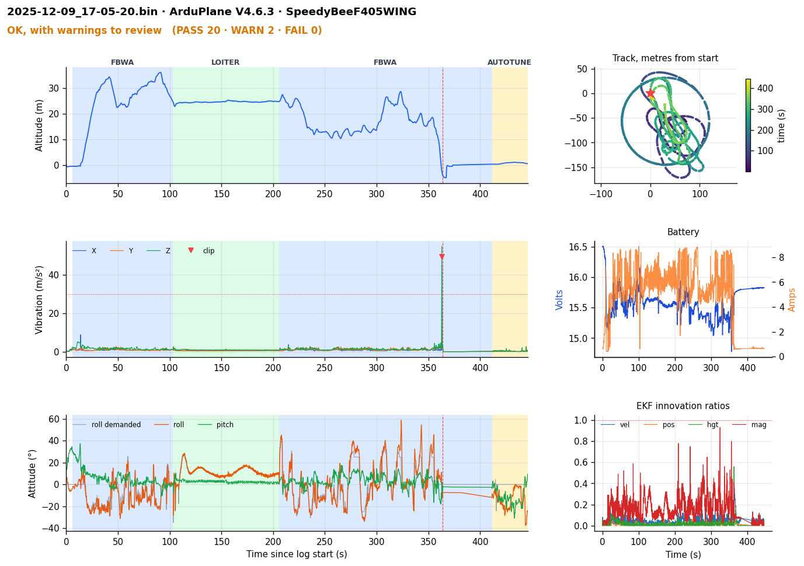

# Log Doctor report: `2025-12-09_17-05-20.bin`

**ArduPlane V4.6.3** on **SpeedyBeeF405WING** · log length 07:25

## ⚠️ OK, with warnings to review

PASS **20** · WARN **2** · FAIL **0**

## Flight

| | |
|---|---|
| Flight time | 5.8 min in 1 flight(s) |
| Max altitude above home | 36 m |
| Max ground speed | 15.6 m/s (56 km/h) |
| Max distance from start | 187 m |
| Distance flown | 3.89 km |
| Battery | 4S, 16.50 V at start, 587 mAh used |

## Checks

| | Check | Measured | Limit |
|---|---|---|---|
| ✅ | Vibration IMU0 (95th pct, in flight) | 2.1 m/s² | < 30 (warn < 60) |
| ✅ | Accel clipping IMU0 (in flight) | 0 | 0 |
| ⚠️ | Accel clipping IMU0 (takeoff / touchdown) | 13 | 0 |
| ✅ | CPU load (95th pct) | 10 % | < 70 % (warn < 85) |
| ✅ | Long loops | 0.00 % | < 5 % (warn < 15) |
| ✅ | Current while disarmed | 0.63 A | < 1 A (warn < 3) |
| ✅ | Battery sag under load | 6.6 % (15.82 → 14.78 V) | < 15 % (warn < 25) |
| ✅ | Lowest cell voltage in flight (4S) | 3.69 V | > 3.5 V (warn > 3.3) |
| ℹ️ | Max current in flight | 8.9 A | – |
| ✅ | EKF velocity innovation ratio (95th pct) | 0.10 | < 0.5 (warn < 1) |
| ✅ | EKF position innovation ratio (95th pct) | 0.04 | < 0.5 (warn < 1) |
| ✅ | EKF height innovation ratio (95th pct) | 0.05 | < 0.5 (warn < 1) |
| ✅ | EKF compass innovation ratio (95th pct) | 0.36 | < 0.5 (warn < 1) |
| ✅ | Compass interference (field change with current) | 1 % | < 30 % (warn < 60) |
| ✅ | Roll tracking error (RMS, in flight) | 6.0° | < 8 (warn < 12) |
| ✅ | Pitch tracking error (RMS, in flight) | 3.7° | < 8 (warn < 12) |
| ✅ | GPS 3D fix (share of log) | 100 % | > 95 % (warn > 80) |
| ✅ | GPS satellites (median) | 21 | ≥ 10 (warn ≥ 6) |
| ✅ | GPS HDOP (median) | 0.56 | < 1.5 (warn < 2.5) |
| ✅ | Gyro noise at rest (IMU0, quietest second) | 0.016 °/s | < 0.3 (warn < 1) |
| ✅ | Pre-arm checks enabled (ARMING_CHECK) | enabled | enabled |
| ✅ | Forced arms (pre-arm checks bypassed) | 0 | 0 |
| ⚠️ | Errors and failsafes (ERR) | 2 | 0 |

## What to look at

- **Accel clipping IMU0 (takeoff / touchdown):** Clipping only at touchdown or launch is usually the impact itself. Fine if the landings are hard by design; otherwise land more gently.
- **Errors and failsafes (ERR):** The flight controller logged errors or failsafes; see the event list for which subsystem.

## Flight modes

| From | To | Mode |
|---|---|---|
| 00:06 | 01:43 | FBWA |
| 01:43 | 03:25 | LOITER |
| 03:25 | 06:51 | FBWA |
| 06:51 | 07:25 | AUTOTUNE |

## Events

| Time | Event |
|---|---|
| 04:01 | ERR Compass: unhealthy |
| 04:01 | ERR Compass: resolved |
| 04:01 | ERR Barometer: unhealthy |
| 04:01 | ERR Barometer: resolved |

---

Generated by [ArduPilot Log Doctor](https://github.com/Prateek-elec/ardupilot-log-doctor). Limits follow common ArduPilot guidance; adjust them for your airframe.
